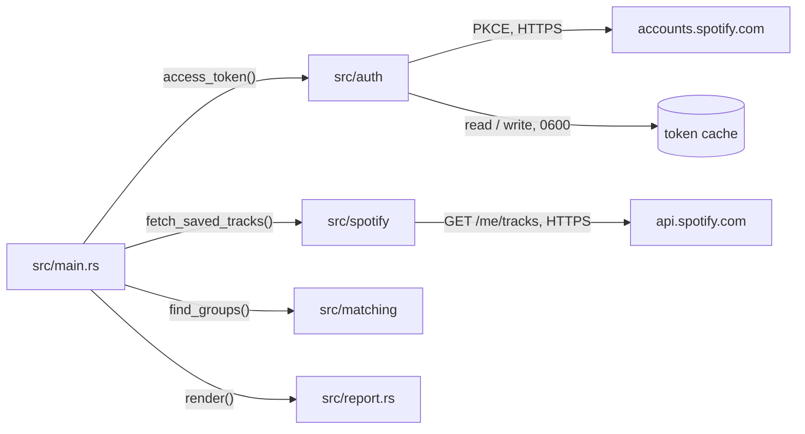
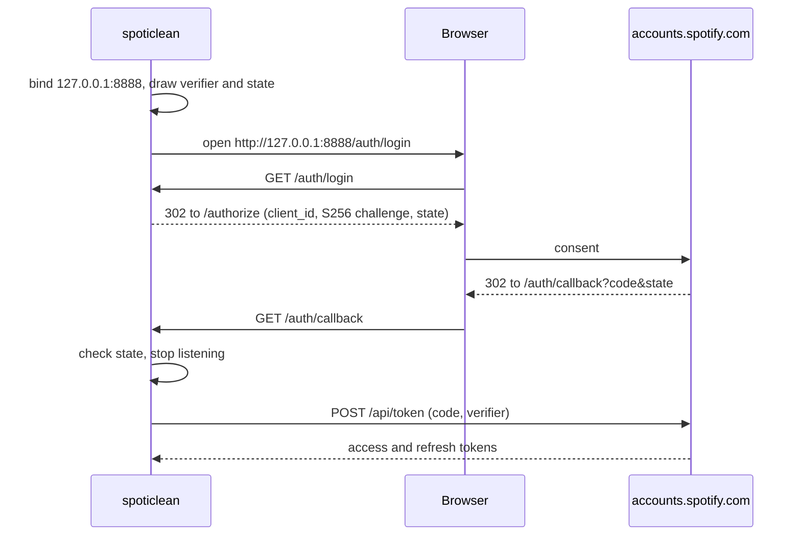

# Architecture

## Overview

spoticlean is a single binary that logs the user in to Spotify, reads their
whole Liked Songs library through the Web API, and prints the tracks that look
like copies of one another. It never writes to the library.

## Components

- **[`src/main.rs`](src/main.rs)** parses the command line, sets up logging,
  and wires the other modules together. It holds no logic of its own.
- **[`src/auth`](src/auth.rs)** returns a usable access token. It owns the
  token cache ([`cache.rs`](src/auth/cache.rs)), the PKCE values
  ([`pkce.rs`](src/auth/pkce.rs)), the local callback listener
  ([`callback.rs`](src/auth/callback.rs)) and the calls to the accounts
  service ([`accounts.rs`](src/auth/accounts.rs)). The `Accounts` trait
  separates the decision (cached, refresh or browser login) from the HTTP
  calls, which is what the tests mock.
- **[`src/spotify`](src/spotify.rs)** reads saved tracks. `Library` is the one
  call the Web API is used for; `SpotifyApi` implements it over HTTPS and maps
  HTTP failures to `ApiError`. [`fetch.rs`](src/spotify/fetch.rs) pages
  through the library on top of any `Library`, with the concurrency and retry
  policy.
- **[`src/matching`](src/matching.rs)** groups tracks. It does no I/O: it
  takes a slice of `Track` and returns groups, so every heuristic is tested
  with plain values. [`normalize.rs`](src/matching/normalize.rs) turns titles
  and artist names into comparable keys.
- **[`src/report.rs`](src/report.rs)** renders the groups as text.

## Data flow

### Login

The browser flow runs only when the cache holds no token for the
`user-library-read` scope, or when refreshing the cached one fails. A token
expiring within five minutes is refreshed first, so it outlives the fetch.

### Fetch

The first page (`limit=50`) gives the library's `total`; the remaining offsets
are then fetched with at most `--concurrency` requests in flight, and
reassembled in offset order. A track ID seen twice is kept once.

A page that fails is retried on its own:

- **429**: wait for `Retry-After` seconds (exponential backoff when it is
  absent). The wait closes a gate shared by every in-flight request, so the
  other pages pause too instead of piling more requests onto the limit.
- **5xx and network errors**: exponential backoff from one second.
- **Anything else** (401, 403, 4xx, undecodable body) fails at once.

### Matching

Two tracks are linked as **duplicates** when either:

1. they carry the same ISRC (normalized to uppercase alphanumerics), or
2. their normalized titles are equal, their artists match (below), their
   versions are equal, and their durations are at most `--duration-tolerance`
   seconds apart.

Linked tracks form groups by transitivity. A group is **certain** when all its
tracks share one ISRC, **probable** otherwise. Separately, tracks with the same
normalized title and matching artists but different versions form a
**variant** group.

Title normalization, in [`normalize.rs`](src/matching/normalize.rs):

- Case, Unicode accents (NFKD, combining marks dropped) and apostrophes are
  ignored; `&` reads as `and`, `Pt.` as `part`, any other punctuation as a
  word boundary.
- Suffixes are found in brackets, `Song (Remastered 2009)`, and after a spaced
  dash, `Song - 2011 Remaster`, then classified one by one:
  - `feat.`, `ft.`, `featuring`, and `with` in brackets name guests, who join
    the track's artists;
  - remaster, deluxe, anniversary or expanded edition, mono, stereo, single or
    album version, `From "…"`, a year: the same recording, dropped;
  - live, acoustic, remix, mix, demo, instrumental, edit, re-recorded,
    `(Someone's Version)` and a few others: a different recording, kept as
    the version label;
  - anything else (`Part 2`, `Interlude`) stays in the title.

Artists match when each track's first artist is credited on the other one.
When both tracks also credit someone else, those extra credits must overlap.

## State and persistence

The only state is the token cache, `token.json` in
`$XDG_CONFIG_HOME/spoticlean/` (`~/.config/spoticlean/` by default). It holds
the access token, the refresh token, the expiry as a Unix time, and the
granted scope. The file is written to a sibling then renamed, so an
interrupted write never leaves it truncated; it is created with mode `0600`,
its directory with `0700`. A corrupt cache is ignored and overwritten by the
next login.

## Design decisions

- **PKCE, no client secret.** A personal CLI cannot keep a secret: anything
  shipped with it is readable by whoever runs it. PKCE proves the token
  request comes from the process that started the login, which is the only
  guarantee a public client can get.
- **The terminal shows a local URL, not the Spotify one.** The authorize URL
  carries the client ID. The browser is opened on `/auth/login`, which the
  listener answers with a redirect to Spotify, so the client ID stays out of
  the terminal and its scrollback, while the printed URL still works when the
  browser fails to open.
- **`127.0.0.1`, not `localhost`.** Spotify rejects `localhost` redirect URIs
  and accepts loopback IP literals over plain HTTP.
- **One connection, one task in the listener.** Browsers open speculative
  connections that never send a request. Serving connections in turn would
  stall the real redirect behind one of them for the whole read timeout.
- **`Retry-After` is capped at two minutes.** When a development-mode app runs
  out of quota, Spotify answers 429 with a wait of hours; failing with that
  wait in the message beats a process that looks hung.
- **Offset pagination in parallel, not `next` links.** Following `next` forces
  one request at a time. The offsets are all known from the first page's
  `total`, so the pages can be fetched concurrently.
- **A remaster with a new ISRC is probable, not certain.** Labels usually
  issue new ISRCs for remasters, so ISRC equality proves a duplicate but its
  absence proves nothing; the name tier catches those.
- **Different recordings are never duplicates.** A live take, a remix or a
  re-recording is often kept on purpose, so those only ever appear in variant
  groups, with the lowest confidence.
- **Unknown suffixes stay in the title.** Dropping every bracket would merge
  `Part 1` with `Part 2`; keeping the unknown ones only costs a missed match
  when a reissue adds an unusual suffix.
- **Durations tell homonyms apart.** Two `Intro`s by the same artist are
  usually different songs, and copies of one recording rarely differ by more
  than a few seconds of silence, hence the ten-second default.
- **Extra credits must overlap.** Classical tracks credit the composer first,
  so the same movement by two orchestras would otherwise look like one
  recording. Pop tracks rarely credit two different sets of guests on copies
  of one recording, so the rule costs little there.

## Invariants and constraints

- **Secrets never reach a log, an error or the terminal.** Tokens, the
  authorization code, the PKCE verifier and the client ID are `SecretString`s,
  whose `Debug` is redacted; none of the types holding them derives `Debug`,
  and `--help` hides the value of `SPOTICLEAN_CLIENT_ID`.
- **Only the report goes to stdout.** Logs and the login prompt go to stderr.
- **The app is read-only.** It requests the `user-library-read` scope and
  nothing else.
- **The redirect URI is fixed**: `http://127.0.0.1:8888/auth/callback` must be
  registered, byte for byte, in the app's settings in the Spotify developer
  dashboard, and port 8888 must be free during a login.
- **Development-mode limits apply**: the app serves only the users added to it
  in the dashboard (`403` otherwise), and its request quota is shared by every
  app of the same developer account.

## Limitations

- The library is read page by page, not as a snapshot: a song saved or removed
  during the fetch can shift the offsets, so a track may be missed, and one
  seen twice is dropped.
- The suffix vocabulary is English. A suffix in another language stays in the
  title, so two copies that differ only by it are not matched.
- Two different songs with the same title, the same artist and close
  durations are reported as probable duplicates.
- Copies of one recording whose durations differ by more than the tolerance,
  and that have different ISRCs, are not matched.
- The token cache's permissions rely on Unix modes.
