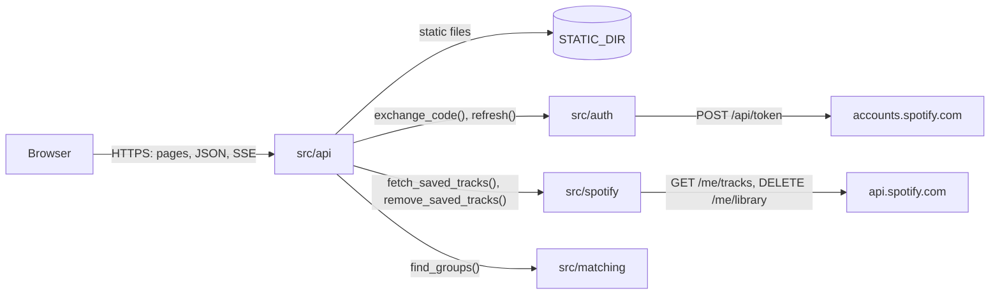
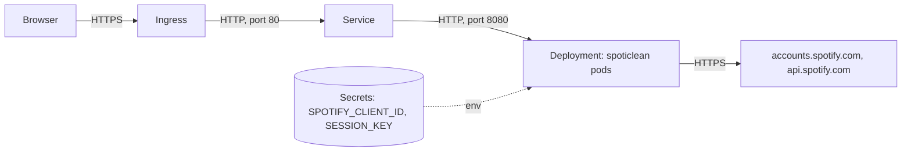
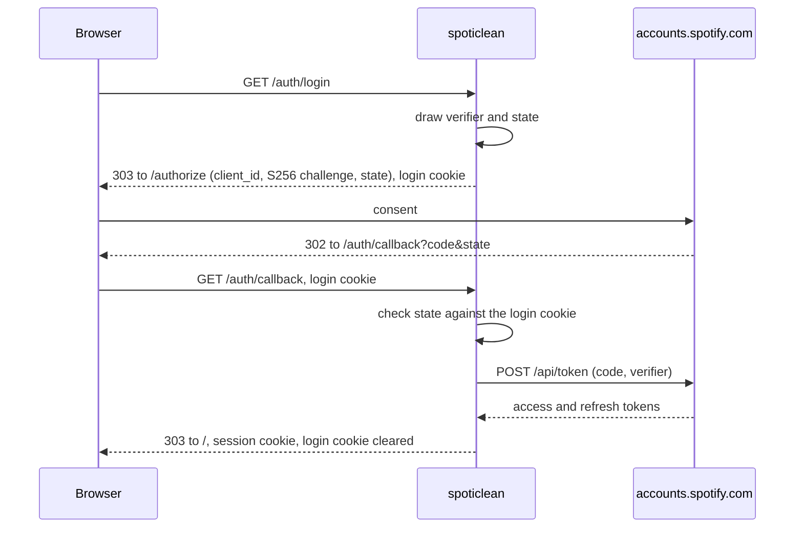

# Architecture

## Overview

spoticlean is a single-user web app. One HTTP server logs the user in to
Spotify, reads their whole Liked Songs library through the Web API, groups the
tracks that look like copies of one another, and removes from the likes the
tracks the user picks. The same server hands out the single-page UI's static
files. It keeps no state of its own: the user's Spotify tokens travel in an
encrypted cookie ([ADR 0001](docs/adr/0001-serve-a-web-app-with-stateless-cookie-sessions.md)).

The [`Dockerfile`](Dockerfile) builds a distroless image that runs the one
binary as UID 65532.

## Deployment

The [Helm chart](charts/spoticlean/README.md) runs the image as one stateless
Deployment behind a Service and an optional Ingress; the cluster's ingress
controller terminates TLS.

- **Replicas share nothing but the session key.** Sessions live in the
  cookie, so a replica count above one needs no sticky routing and no store;
  every replica reads the same `SESSION_KEY`.
- **Credentials come from Secrets.** The client ID and the session key are read
  from Secrets through `secretKeyRef`, which can be Secrets the chart does not
  own, so a GitOps repository never holds them. The chart can also generate
  them from values, for a quick install.
- **`PUBLIC_URL` follows the ingress.** It is the explicit `app.publicUrl`, else
  the origin of the ingress host, `https` unless TLS is off, so the redirect URI
  and the `Secure` cookie flag agree with how the browser reaches the app. A
  TLS-terminating proxy the chart does not know about needs `app.publicUrl`.
- **The pod is locked down to match the image.** It runs as UID and GID 65532
  with a read-only root filesystem, no capabilities and no service-account
  token, since the app writes nothing and never calls the Kubernetes API.
- **Probes hit `GET /healthz`**, which touches neither Spotify nor any state.
  On `SIGTERM` the server drains in-flight requests within the pod's
  termination grace period.
- **Trust anchors are overridable.** Outbound TLS goes to Spotify only; a
  private or corporate CA bundle mounts from a Secret or ConfigMap and is
  pointed at by `SSL_CERT_FILE`.

## Components

- **[`src/main.rs`](src/main.rs)** parses the configuration, sets up logging,
  builds the Spotify clients and serves the router until `SIGTERM` or
  `SIGINT`. It also holds the `healthcheck` command the container uses. It
  holds no logic of its own.
- **[`src/api`](src/api.rs)** is the HTTP surface, built with `axum` and
  documented with `aide`, which serves the OpenAPI document at
  `/openapi.json` and its Scalar rendering at `/docs`.
  [`oauth.rs`](src/api/oauth.rs) runs the browser side of the login,
  [`session.rs`](src/api/session.rs) seals and opens the cookies and renews
  the access token, [`scan.rs`](src/api/scan.rs) streams a scan,
  [`removals.rs`](src/api/removals.rs) removes tracks, and
  [`error.rs`](src/api/error.rs) turns every failure into one problem shape.
  The handlers map domain types to dedicated DTOs; no domain type is
  serialized.
- **[`src/auth`](src/auth.rs)** talks to the accounts service. The `Accounts`
  trait has the two token calls, `exchange_code` and `refresh`;
  [`pkce.rs`](src/auth/pkce.rs) draws the verifier and the `state`, and builds
  the consent URL.
- **[`src/spotify`](src/spotify.rs)** talks to the Web API. `Library` has the
  two library calls, `saved_tracks` and `remove_saved_tracks`, each taking the
  user's access token; `SpotifyApi` implements them over HTTPS and maps HTTP
  failures to `ApiError`. [`retry.rs`](src/spotify/retry.rs) is the 429 and
  5xx policy every call goes through, [`fetch.rs`](src/spotify/fetch.rs)
  pages through the library, and [`remove.rs`](src/spotify/remove.rs) removes
  tracks in batches.
- **[`src/matching`](src/matching.rs)** groups tracks. It does no I/O: it takes
  a slice of `Track` and returns groups, so every heuristic is tested with
  plain values. [`normalize.rs`](src/matching/normalize.rs) turns titles and
  artist names into comparable keys.

`Accounts` and `Library` are the seams the tests mock: the router is built
over either the HTTPS clients or `mockall` doubles, and the API tests drive it
in process.

## Data flow

### Login

The login cookie carries the PKCE verifier and the `state` for ten minutes,
on `/auth` only. A callback whose `state` does not match it, or that comes
without it, never reaches the token endpoint. A failed login redirects to
`/?authError=<code>` so the UI can say why.

### Every authenticated request

A middleware opens the session cookie. A missing, forged or undecryptable
one is a `401`. An access token that expires within five minutes is refreshed
first, and the renewed cookie goes back with the response; Spotify may not
rotate the refresh token, in which case the previous one is kept. A refresh
that Spotify refuses clears the cookie and answers `401`; one that cannot
reach Spotify answers `502` and keeps the cookie.

### Scan

`GET /api/v1/scan` answers with server-sent events. The first page of the
library (`limit=50`) gives its `total`; the remaining offsets are then fetched
with at most `SCAN_CONCURRENCY` requests in flight, and reassembled in offset
order. A track ID seen twice is kept once. Each page that arrives sends a
`progress` event (`fetched`, `total`); the end sends one `result` event with
the groups, or one `error` event with a problem, and closes the stream.

The scan runs inside the response body. A client that disconnects drops the
stream, which drops the requests still in flight to Spotify.

### Removal

`POST /api/v1/removals` takes track IDs, drops the repeated ones, and sends
them to `DELETE /me/library` as `spotify:track:` URIs, 40 at a time (the
endpoint's limit), one batch after the other. A failed batch does not stop
the next one, unless the failure is bound to repeat (a rejected token, a
refused access, a quota exhausted for longer than the policy waits), in which
case the remaining batches are reported as skipped. The answer is `200` when
every track is removed, `207` with the removed IDs and the failed batches
when only some are, and the first failure's status when none is.

### Retries

Every Web API call goes through the same policy:

- **429**: wait for `Retry-After` seconds (exponential backoff when it is
  absent). The wait closes a gate shared by every request of the same scan or
  removal, so the others pause too instead of piling onto the limit.
- **5xx and network errors**: exponential backoff from one second.
- **Anything else** (401, 403, 4xx, undecodable body) fails at once.

### Matching

Two tracks are linked as **duplicates** when either:

1. they carry the same ISRC (normalized to uppercase alphanumerics), or
2. their normalized titles are equal, they are the same song (below), they
   name the same version, they credit the same people, and their durations
   are at most `DURATION_TOLERANCE` seconds apart.

Linked tracks form groups by transitivity. A group is **certain** when all its
tracks share one ISRC, **probable** otherwise. Separately, tracks of the same
song that differ by their version or by who they credit form a **variant**
group.

Two tracks are the same song when each one's first artist is credited on the
other. When both also credit someone else, those extra credits must overlap.
The credits are the artist list plus the names in the title's featuring
suffixes, so a guest moved from `(feat. X)` to the artist list counts once,
while a guest credited on one side only marks a different recording.

Title normalization, in [`normalize.rs`](src/matching/normalize.rs):

- Case, Unicode accents (NFKD, combining marks dropped) and apostrophes are
  ignored; `&` reads as `and`, `Pt.` as `part`, any other punctuation as a
  word boundary.
- Suffixes are found in brackets, `Song (Remastered 2009)`, and after a spaced
  dash, `Song - 2011 Remaster`, then classified one by one:
  - `feat.`, `ft.`, `featuring`, and `with` in brackets name guests, who join
    the track's credits;
  - remaster, deluxe, anniversary or expanded edition, mono, stereo, single or
    album version, `From "…"`, a year, and a year followed by `Remix` or
    `Mix` (`2018 Remix`): the same recording, dropped;
  - live, acoustic, remix, mix, demo, instrumental, edit, re-recorded,
    `(Someone's Version)` and a few others: a different recording, kept as
    the version;
  - anything else (`Part 2`, `Interlude`) stays in the title.

Each track also carries its `versionLabel`, the version and reissue suffixes
as written (`Remastered 2009`, `Live`), for display.

## State and persistence

The server stores nothing. State lives in two cookies, both sealed with
AES-256-GCM under `SESSION_KEY`, with the cookie name as associated data,
`HttpOnly`, `SameSite=Lax`, and `Secure` when `PUBLIC_URL` is HTTPS:

| Cookie | Path | Lifetime | Holds |
| --- | --- | --- | --- |
| `spoticlean_session` | `/` | 30 days, renewed with the access token | access token, refresh token, expiry, granted scopes |
| `spoticlean_login` | `/auth` | 10 minutes | PKCE verifier, `state` |

What the user decides about a group (dismissed, promoted to duplicate, the
copy to keep) belongs to the UI, which keeps it in the browser under the
group's `key`.

## Design decisions

- **Server-side redirect flow with PKCE, no client secret.** The server could
  keep a secret, but PKCE already proves the token request comes from the
  login that started it, and a secret would only be one more credential to
  store and rotate. The client ID is configuration, never logged.
- **Tokens in an encrypted cookie, not a store**
  ([ADR 0001](docs/adr/0001-serve-a-web-app-with-stateless-cookie-sessions.md)).
  A restart or a second replica logs no one out, and there is nothing to
  operate; the price is that a session cannot be revoked server-side.
- **Server-sent events for the scan's progress, not a polled scan resource.**
  A scan resource would have to live somewhere between polls, which a
  stateless server does not have: in memory it breaks with two replicas or a
  restart, and it needs expiry. One streamed `GET` carries the progress and
  the result over one connection, stores nothing, and cancels the work when
  the client leaves. The endpoint is a `GET` because a scan only reads, which
  is also what lets a browser `EventSource` call it.
- **The scan's result is not paginated.** It is computed from one pass over
  the whole library and cannot be resumed at an offset without being stored;
  its size is bounded by the library itself.
- **The keep rule is the UI's.** Each group gives, per track, the raw facts the
  rules compare (release date, liked date, version label), with tracks sorted
  by release date then liked date. Changing the rule, or overriding it for a
  group, then needs no new scan.
- **Group keys come from the names, not the order.** A duplicate group's key
  hashes the smallest identity among its tracks (normalized title, version and
  credits, or the ISRC for a track whose name says nothing); a variant group's
  hashes the title and first artist. The key stays the same across scans, and
  when a group moves between certain and probable, as long as its tracks keep
  their names. Two groups that would share a key, such as two pairs of homonym
  `Intro`s, are told apart by their smallest track ID.
- **Removal is a `POST` of a record, not a `DELETE` with IDs.** A list of
  hundreds of IDs does not fit in a URL, and a `DELETE` body is ignored by too
  many intermediaries. The record is not stored, so the answer carries the
  outcome instead of a `Location`.
- **`207` for a partial removal.** Some tracks removed and others not is
  neither a success nor a failure, and the caller needs both lists to show
  what is left.
- **`Secure` follows `PUBLIC_URL`.** Browsers drop `Secure` cookies set over
  plain HTTP, which is how the app runs on `127.0.0.1`.
- **`Retry-After` is capped at two minutes.** When a development-mode app runs
  out of quota, Spotify answers 429 with a wait of hours; failing with that
  wait in the message beats a request that looks hung.
- **Offset pagination in parallel, not `next` links.** Following `next` forces
  one request at a time. The offsets are all known from the first page's
  `total`, so the pages can be fetched concurrently.
- **A remaster with a new ISRC is probable, not certain.** Labels usually
  issue new ISRCs for remasters, so ISRC equality proves a duplicate but its
  absence proves nothing; the name tier catches those.
- **Different recordings are never duplicates.** A live take, a remix or a
  re-recording is often kept on purpose, so those only appear in variant
  groups, with the lowest confidence. A dated remix (`2018 Remix`) is the
  exception: labels use it for a reissue of the artist's own record, the way
  they use `Remaster`, while someone else's remix is named after them.
- **A guest on one side only is a different recording.** Re-recordings with
  new guests keep the title and the duration of the original, so the credits
  are what tells them apart; copies of one recording credit the same people,
  in the title or in the artist list.
- **Unknown suffixes stay in the title.** Dropping every bracket would merge
  `Part 1` with `Part 2`; keeping the unknown ones only costs a missed match
  when a reissue adds an unusual suffix.
- **Durations tell homonyms apart.** Two `Intro`s by the same artist are
  usually different songs, and copies of one recording rarely differ by more
  than a few seconds of silence, hence the ten-second default.
- **Extra credits must overlap.** Classical tracks credit the composer first,
  so the same movement by two orchestras would otherwise look like one song.

## Invariants and constraints

- **Secrets never reach a log, an error or a response.** Tokens, the
  authorization code, the PKCE verifier, the client ID, the session key and
  the cookies' contents are `SecretString`s or sealed values; none of the
  types holding them derives `Debug`, `--help` hides the values of
  `SPOTIFY_CLIENT_ID` and `SESSION_KEY`, and the request span records the
  path without the query, which holds the code on `/auth/callback`.
- **Cross-site requests carry no session.** `SameSite=Lax` keeps the cookie off
  cross-site `POST` and `DELETE`, and the removal only accepts
  `application/json`, which a cross-site form cannot send.
- **The redirect URI is `PUBLIC_URL` + `/auth/callback`**, and must be
  registered, byte for byte, in the app's settings in the Spotify developer
  dashboard. `PUBLIC_URL` is an origin: the app is served at the root.
- **The scopes are `user-library-read` and `user-library-modify`**, nothing
  else.
- **Development-mode limits apply**: the app serves only the Spotify accounts
  added to it in the dashboard (`403` otherwise), its owner needs Spotify
  Premium, and its request quota is shared by every app of the same developer
  account.
- **Paths under `/api/` never fall back to the UI**: an unknown one is a `404`
  problem, so a mistyped API call fails loudly instead of returning HTML.

## Limitations

- A session cannot be revoked server-side: a leaked cookie stays valid until
  its refresh token is revoked from the Spotify account's app settings, or
  `SESSION_KEY` changes, which logs everyone out.
- The library is read page by page, not as a snapshot: a song liked or removed
  during the scan can shift the offsets, so a track may be missed, and one
  seen twice is dropped.
- The suffix vocabulary is English. A suffix in another language stays in the
  title, so two copies that differ only by it are not matched.
- Two different songs with the same title, the same credits and close
  durations are reported as probable duplicates.
- Copies of one recording whose durations differ by more than the tolerance,
  and that have different ISRCs, are not matched.
- A copy credited with a guest its twin omits is reported as a variant, not a
  duplicate.
