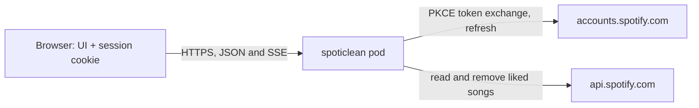

# 0001. Serve a single-user web app whose sessions live in an encrypted cookie

- **Status**: accepted
- **Date**: 2026-10-30

## Context

spoticlean is a command-line tool: it logs in through a loopback redirect,
caches the Spotify tokens in a file, reads the Liked Songs and prints the
groups of duplicates. It never writes to the library.

Reviewing a few hundred groups as text, choosing per group which copy to
keep, and removing the others is a job for a UI. The owner wants one at
`https://spoticlean.gleroy.dev`, deployed on a Kubernetes cluster with a Helm
chart, for their own account only.

Spotify constrains the design. An app in development mode only serves the
Spotify accounts added to it in the developer dashboard, and needs one
redirect URI registered per origin. Removing a track needs the
`user-library-modify` scope on top of `user-library-read`.

## Decision

We replace the CLI with an HTTP server that serves a JSON API and the static
files of a single-page UI, built into one container image and deployed with a
Helm chart.

The server logs the user in with the Authorization Code flow with PKCE, as a
redirect between the browser, the server and Spotify, without a client
secret. It keeps no state: the access and refresh tokens are stored in a
session cookie, encrypted and authenticated with a key from the environment
(AES-256-GCM), `HttpOnly`, `Secure` and `SameSite=Lax`. Every request
decrypts it, renews the access token when it is about to expire, and sends
the renewed cookie back. There is no database and no server-side session
store. Who may log in is decided by the Spotify development-mode allowlist,
with no allowlist of our own.

## Consequences

- The pod is disposable: a restart, a redeploy or a second replica logs no
  one out, and there is no datastore to run, back up or migrate.
- One image holds the API and the UI, served from one origin: no CORS, and
  the cookie never leaves that origin.
- A session cannot be revoked server-side. A stolen cookie works until its
  refresh token is revoked from the Spotify account page, or until the key
  changes, which logs everyone out. Losing the key means the same.
- The cookie bounds what a session can hold to about 4 KB; two tokens fit
  with room to spare, anything larger does not.
- Whatever the user decides about a group (dismissed, promoted) has no server
  to live on, so it stays in the browser, and does not follow the user to
  another one.
- Nothing survives between requests, so every scan reads the whole library
  again, and its progress can only reach the request that runs it.
- Access control is Spotify's. Leaving development mode would open the app to
  every Spotify account, and would need an allowlist of our own first.

## Alternatives considered

- **Keep the CLI and add removal**: a terminal makes reviewing hundreds of
  groups and overriding a choice per group tedious, and the owner wants the
  app reachable from any device.
- **Sessions in Redis or PostgreSQL**: a second service to run and back up,
  for one user's two tokens; it would buy server-side revocation only.
- **A UI-only app doing PKCE in the browser**: no server to run, but the tokens
  would sit where any script on the page can read them, and the matching code
  would have to be ported to the browser.
- **A confidential client with a client secret**: PKCE already ties the code
  to the login that requested it; a secret would only add one more credential
  to store and rotate.
- **Separate images for the API and the UI**: two deployments and a
  cross-origin cookie for an app this size.
